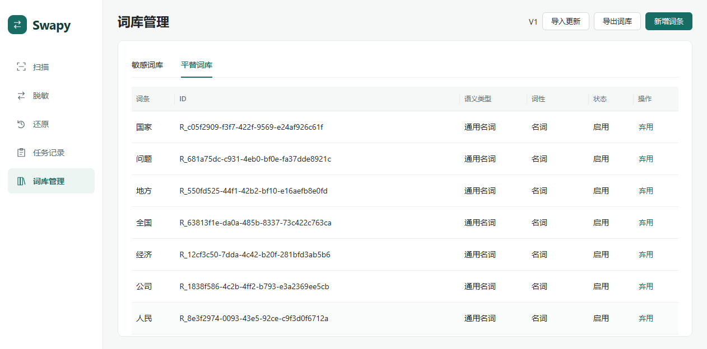

# 浏览器词库导入验证

本文记录先前细分类库的测试；当前基础版已采用十类和CSV，见[新基础库验证](basic-csv-verification.md)。

日期：2026-11-24。使用独立 Chromium 自动化会话，在空的隔离测试库操作实际页面；未向正式服务导入测试数据。

## 操作与结果

1. 打开词库管理，点击“导入更新”，通过文件输入控件选择 SwarpyDB 的 `swapy-library-v1.json`，约 26 MB。
2. 等待实际上传和 SQLite 事务完成，页面显示 V1；切换平替词库后显示每页 12 条，共 9,600 页。
3. 第 2 页第一条为“历史”；第 9,600 页显示工单编号 10003588–10003599，共 12 行。
4. 只读检查测试 SQLite，`pool` 记录数为 115,200。浏览器无未捕获异常。

## 发现并修复的问题

原页面每秒请求完整词库，导入后多次重复下载约 26 MB，且慢请求相互重叠。实际观察到 20 次完整下载，证明不能仅以接口返回成功认定页面可用。

修复后 `/catalog` 用词库谱系、版本及只读配置产生 ETag；不变时只查询发布元数据并返回 304，不读取／序列化整个词库。浏览器使用条件请求并合并尚未结束的词库读取；导入按钮在处理中显示加载状态。

复测中导入后只有 1 次完整词库 GET，随后观察到 44 次 304、正文均为 0 字节；完整词库变化后仍会读取新版本。首次上传响应仍携带完整结果，初次加载仍需传输词库，本轮未实现服务端分页。

## 回归与环境

新增真实 HTTP 测试验证：首读提供 ETag、不变时 304 且无正文、添加词条后旧 ETag 失效、新版本可见、弱校验标签可返回 304。该测试在修复前因没有 ETag 失败。

`mvn -o -f backend/pom.xml verify`：50 项通过，0 失败、0 错误、0 跳过；`node --check prototype/live.js` 通过。测试服务与自动化浏览器均已关闭，正式本地服务恢复到端口 4175，词库数据未改动。
