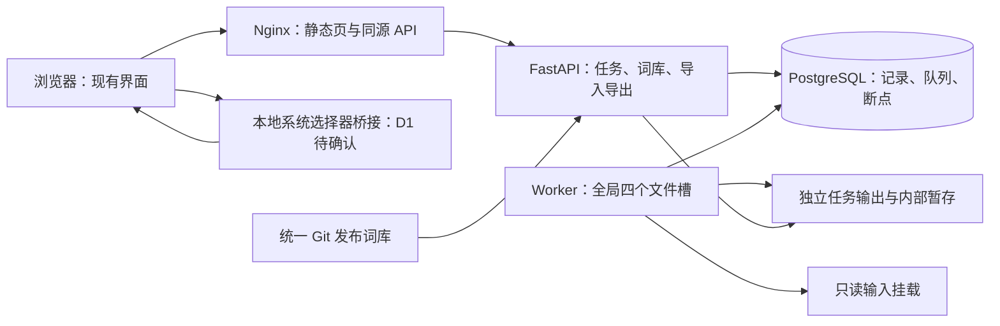

# Swapy 后端开发设计方案

日期：2026-11-23　版本：草案 2（独立审查修订）　状态：待用户审核，未授权实施。

> **后续变更优先**：用户最新恢复扫描断点执行，取代此前取消断电恢复的决定。扫描在暂停、服务重启或断电后沿用原任务号继续，持久保存文件级断点，跳过已完成且未变动文件；未提交完成结果的文件重新处理。脱敏、还原仍保留中断产物，重跑创建新任务。本文扫描断点相关流程与验收要求恢复有效。另已确认 D1 文件位置以主机／共享盘为主；本地 Java + SQLite 架构正在讨论，本文原 Python/PostgreSQL 方案尚未随之重新设计或获批，不能直接执行。

依据：[需求规格](../../requirements-v1.1.md)、[决策记录](../../requirements-decisions.md)、[词库发布 ADR](../../adr/0001-unified-library-releases.md)、[原型交换约定](../../prototype-transfer.md)。已确认需求优先；本文标为“建议”的内容是本次设计选择，不代表用户已经同意。原型仅验证交互和记录交换，不能作为真实文档处理与断电恢复的实现依据。

## 1. 审核摘要

建议采用 **Python FastAPI + PostgreSQL + 独立 worker + Nginx**，组成一套 Docker Compose 应用。现有 React 17 / Ant Design 4 页面接真实 API，保留 Chrome/Edge 80+、全窗口、异常项展示及各执行页面独立进度的约定。

本轮交付设计和审查记录。用户审核通过后，才形成可执行开发计划、搭建后端、安装依赖并实现。以下五项会影响实现，需与整份方案一并审核：

| 编号 | 需要确认的边界 | 本方案建议 |
| --- | --- | --- |
| D1 | 系统选择器、不上传、Docker 能访问的文件位置 | 首期处理 Docker 主机或已挂载共享盘；使用小型本地选择器桥接程序打开系统对话框，只传根目录 ID 和相对路径。任意远端电脑本地目录需要共享挂载或另行设计本地执行代理 |
| D2 | 固定四路的作用范围 | 全服务共享 4 个文件处理槽，扫描、脱敏、还原公平分配；单任务最多占 4 路。若要求每种任务各 4 路，则需改为最多 12 路的容量设计 |
| D3 | 英文大小写无损还原 | 同一个英文词仍分配一个基础平替词；选择可逐字母传递大小写的候选，不满足可逆条件的候选重选，耗尽则跳过并报告，不引入一词多替 |
| D4 | 文档非正文区域、PDF 适配 | 建议纳入页眉页脚、脚注尾注、批注和文本框；必须按区域通过样例验收。PDF 写回引擎及其分发许可作为实现前技术验证项；失败不得降格输出纯文本 |
| D5 | 部分原文无法读取时的避重承诺 | 建议不可完整提取文本的文档整文件失败、不输出，继续处理其余完整可提取文件；避重保证限定为实际纳入脱敏的完整输入集合。严格要求检查任何不可读原文则无法同时保证继续脱敏其他文件，需要用户确定取舍 |

其他参数、表结构、内部模块和错误码可由开发按本文执行，无需逐项提问。D1 当前尚待文件位置答复；在明确前不把浏览器本地目录当成服务器目录。

## 2. 架构选择与边界

### 2.1 可行路线比较

| 路线 | 适用性 | 代价与结论 |
| --- | --- | --- |
| FastAPI + PostgreSQL + Python worker | 文本、结构格式、Office、PDF 适配集中；API 与处理进程分离 | 推荐。数据库同时保存业务记录和持久工作队列，固定 4 路暂不引入额外队列服务 |
| Node/NestJS API + Python 文档服务 | 前后端 JavaScript/TypeScript 一致 | 需维护两套运行时与跨服务契约，当前没有正式 Node 后端约束，不作为首选 |
| 单进程 API + SQLite + 内存队列 | 演示部署简单 | 不作为正式方案：长任务、进程重启恢复、四路并发写入和导入事务会集中在单进程中 |

数据库拟用 PostgreSQL 16，Python 拟用 3.12；实施时核验维护状态、依赖兼容性并锁定补丁版与镜像摘要。既有原型依赖不因此升级。独立 worker 承担重任务；不使用路由进程内的 BackgroundTasks 保存关键任务。[FastAPI 官方说明](https://fastapi.tiangolo.com/tutorial/background-tasks/)



不调用大模型；不增加服务设置页面；不加入 OCR、独立源码处理、压缩包改写或原件上传流程。词库、密码包上传属于记录交换，不属于上传原文。

### 2.2 文件选择与文件权限

Docker bind mount 来自 Docker daemon 所在主机，不能通过远端浏览器传来的路径直接挂载客户端磁盘。[Docker bind mount 文档](https://docs.docker.com/engine/storage/bind-mounts/)

浏览器目录选择返回的 `webkitRelativePath` 是相对于所选目录的路径，不能充当服务端绝对定位依据。[MDN 文档](https://developer.mozilla.org/en-US/docs/Web/API/File/webkitRelativePath)

建议的首期操作链路：

1. 运维在部署配置中登记输入、输出根目录，将输入只读挂载给 worker；界面不出现服务设置。
2. 选择器桥接程序运行在有这些目录访问能力的操作系统上，打开系统文件或文件夹对话框。选择成功后映射为 `{root_id, relative_path, kind}`；扫描页立即创建扫描任务。
3. 浏览器只传目录引用和短期选择凭证。API 校验凭证与允许根目录，worker 解析实际路径并再次检查边界；不接收任意绝对路径作为执行权限。
4. 任务持久保存根目录引用；断电后由服务端重新读取挂载目录，不依赖浏览器重新上传 File 对象。

桥接仅提供选择能力，不读取上传原件。仅允许受信任的同源站点调用，使用单次 nonce、短期签名凭证并校验来源；不能暴露任意路径读取接口。Windows 主机可由 Python 小程序调用原生文件对话框，作为单独安装的薄组件，不改变主系统 B/S 架构。

**部署边界**：若浏览器运行在另一台电脑，原生选择器必须运行在那台电脑；其所选目录只有在服务器存在对应共享挂载时才能处理。若需要任意客户端本地目录且不能共享，必须另做本地执行代理；若同时拒绝本地组件、原文上传和共享挂载，则不能满足当前全部要求。网页模拟目录树可以作为另一个方案，但不能冒充系统文件浏览器。

路径统一使用 UTF-8 的相对路径与独立 root ID；拒绝 `..`、绝对路径、驱动器注入和越界链接。默认不跟随符号链接与目录联接，报告跳过；打开时再次校验，处理期间检测源文件变化。输出根目录不能与输入相同，输入子树中的所有 Swapy 任务目录自动排除。

## 3. 模块与持久数据

建议后续目录布局，现阶段不创建代码：

```text
backend/swapy/
  api/                 HTTP 请求、DTO、错误响应
  tasks/               状态机、幂等、进度、任务查询
  scheduler/           四路槽、租约、恢复、目录发现
  filesystem/          根目录、路径校验、名称规划、产物提交
  matching/            边界、重叠、属性、候选避重
  mapping/             一对一映射、大小写变换、A/B 编码
  adapters/            文本、Markdown、结构文本、SQL、Office、PDF、压缩包
  catalog/             ID、发布、同步、导入、历史查询
  packages/            密码包、合集、完整 JSON、可视化密码本
  reports/             文件异常索引、HTML 报告
  persistence/         表模型、事务、迁移
  worker/              独立进程入口及受限子进程执行
```

核心服务依赖 Repository 与 FileStore 接口，HTTP 层不直接操作文档。适配器统一执行 `probe → extract → plan_patches → write → validate`；扫描只执行提取及匹配。核心不按扩展名散落条件分支，新增格式通过能力注册表加入。

| 表或实体 | 关键字段与约束 |
| --- | --- |
| global_ids | ID 主键、类型、首次登记时间；权威发布库统一约束双词库 ID，不复用已弃用 ID |
| word_entries | ID、库类型、原始词面、词性、语言形态、语义类型、相关性标签、属性来源、introduced_version；发布后内容不可变 |
| word_events | entry_id、deprecated_at_version、原因；弃用追加事件，不删除或重写原记录 |
| catalog_releases | lineage_id、递增 version、Git commit、manifest_hash、parent_hash、状态；每版唯一且不可变 |
| tasks | ID、kind、status、phase、输入输出引用、mode、register_id、key、创建及完成时间、创建与实际版本、required_version、record_hash |
| task_sources / discovery_frontier | 源相对路径、遍历目录游标记录、发现状态；唯一任务与逻辑路径，目录遍历可恢复 |
| work_items | task_id、file_id、归档成员链、源指纹、阶段、状态、attempt、lease_generation、lease_until；阶段结果唯一 |
| work_groups / group_members | task_id、group_kind、状态、generation、成员 work_item；SQL 一致性组全成员校验完成后短事务整体就绪 |
| worker_slots | 固定 4 行、占有任务、generation、心跳与过期时间；服务端容量约束 |
| task_mappings | task_id、source_id、replacement_id 或规则生成记录、变换算法版本、实际词面必要补充；源与目标各有任务内唯一约束 |
| path_mappings | 原相对路径、输出相对路径、源文件 ID、生成文件 ID、前缀状态；预留路径不能冲突 |
| task_artifacts | 文件 ID、不可变尝试产物路径、大小、摘要、发布状态、生成 attempt；只关联当前有效提交 |
| task_issues | task_id、file_id、归档路径链、错误码、词及频次、原因、实际输出引用；按任务及文件分页 |
| package_imports / export_jobs | 请求幂等键、批次、校验结果、内容摘要、暂存位置、状态与完成产物 |
| task_events / publish_outbox | 单调序号、事件类型、必要载荷；用于进度重连与 Git 发布补偿 |

普通文件清单在服务端维护，不提供给执行页展示。内部文件记录与“只显示异常文件”互不冲突。文件 ID 用任务内稳定 ID；归档成员标识包含整条成员链，不能仅用末级名称。

任务 ID 建议 `T_<UUIDv4>`，词条 ID `S_<UUIDv4>` / `R_<UUIDv4>`；不依赖词面或时间戳。key 采用独立随机凭据，注册 ID 使用独立 UUID 的短展示形式，完整值登记；短值冲突时扩展长度。任务与 key、注册 ID 在数据库分别唯一。所有导入 task ID 必须与三类本地任务统一检查冲突。

词条跨部署新增由统一发布端先登记、唯一约束成功后发布；客户端导入保留 ID。离线编辑为未发布草稿，不能自行制造与权威版本并列的正式词库。随机生成仅负责提供候选 ID，数据库登记与冲突拒绝负责正确性。

## 4. 任务状态、四路并行和进度

### 4.1 状态机

```text
扫描：CREATED → DISCOVERING → PROCESSING → FINALIZING → SUCCEEDED / PARTIAL / FAILED
                  ↓                ↓
               PAUSING → PAUSED → RECOVERING → 原阶段

脱敏：CREATED → DISCOVERING → PREFLIGHT → PROCESSING → FINALIZING → 终态
还原：CREATED → RESOLVING  → DISCOVERING → PROCESSING → FINALIZING → 终态
脱敏/还原中断：INTERRUPTED，保留已提交文件与映射；重新执行创建新任务
```

`phase` 与 `status` 分开。文件可为成功、未命中复制、部分脱敏、失败、跳过、未扫描；任务终态汇总，不能把跳过或未检查计为成功。`PARTIAL` 携带 `scan_incomplete`、`partial_redaction` 等原因标志。进程意外停止后，脱敏/还原不自动继续改写，清理未提交尝试后标记中断。

扫描自动重启恢复原任务，用户主动暂停的任务仍暂停；输入挂载缺失时保持 `WAITING_FOR_SOURCE` 并提示，不能丢弃断点或静默重建新任务。

### 4.2 四路调度建议

全局维护 4 个槽，按可运行任务轮转分配文件级工作，单任务最多 4 路。有扫描、脱敏、还原同时运行时，每个可运行任务先得到一个槽，空余槽继续公平分配。已在处理的文件不强行抢占；其他任务在当前文件完成或超时后得到槽。不承诺同一毫秒内启动全部任务。

目录发现、提取预检、正文扫描、格式转换及写回都受这 4 路处理预算约束；不能每个 API 各启动一个四进程池。Office/PDF 子进程占用所属槽，不能额外绕过容量限制。轻量 API、报告聚合和数据库事务不占文件槽。

数据库行锁领取工作使用 `FOR UPDATE SKIP LOCKED`，配合短事务与租约；不在处理文档期间持有事务。[PostgreSQL SELECT 文档](https://www.postgresql.org/docs/16/sql-select.html)

建议租约 60 秒、心跳 10 秒；这些是内部参数，不增加用户调整项。租约 generation 作为提交栅栏，旧 worker 即使恢复也不能提交失效结果。服务重启可重新领取扫描工作；计算允许重试，业务结果只接受一个有效版本，不宣称文件系统和数据库天然具备跨系统原子事务。

### 4.3 进度语义

响应固定包含 `phase, discovered, total, total_known, processed, succeeded, partial, failed, skipped, unscanned, active_workers, checkpoint_at, event_seq`。

发现阶段 `total_known=false`，展示“解析总目标”和已发现数，不伪造百分比。归档发现完成后再给确定总数；归档无法打开等也形成一个可计数异常目标。内容处理完成数只计叶级逻辑文档，不重复计算包容器。脱敏预检与写回分阶段进度；预检结束不显示任务 100%。

前端先用 1–2 秒轮询；可增强为 SSE，同源 Cookie 与 Last-Event-ID 重连，断线回退轮询。任务页面、各配置页面均查询服务端状态，不用 localStorage 推进任务。切页、关页、重开浏览器不终止服务端任务。

## 5. 扫描、断点和增量

1. 创建任务时持久保存输入引用、输出目录、规则版本和发现根目录；任务目录以新任务 ID 独占创建。
2. 目录发现将子目录前沿和文件 work item 持续提交，唯一约束去重。重启重新枚举未完成目录即可，不依赖不可恢复的系统目录迭代句柄。
3. 每个文件记录大小、mtime_ns、可取得的系统文件身份及 SHA-256。增量模式先按元数据判断，再按摘要验证；正确性优先，不能仅凭同大小同时间认定内容未变。
4. 扫描缓存键包括内容摘要、提取器版本、规则版本及词库版本。恢复同一任务沿用已提交文件；若源已变动则失效并重新扫描，消除旧问题计数后提交新结果。缺失源文件记异常。
5. 新任务增量扫描可复用同规则、同库、同内容缓存。词库或规则变化后用户可手动选择强制重扫未变文件；不自动重扫历史任务。
6. 结果与计数在同一事务提交。崩溃发生在读取之后、提交之前，则重新处理该文件；完成后的文件不因浏览器状态丢失而重做。

整个任务是逐文件采样的扫描，不是文件系统快照；记录各文件读取时刻。目录发现完成后新增文件留待下一次手动扫描，避免持续新增导致任务永远不能完成。

## 6. 匹配、分配与无损还原算法

### 6.1 匹配边界与重叠

中文连续字串匹配。英文仅做 ASCII A–Z/a–z 不区分大小写，不隐式折叠 Unicode 字形；词前后遇到 ASCII 字母、数字、下划线视为词内，中文或标点视为边界。数字代号按登记的完整 token 处理，边界同英文；混合词按词条语言形态对应规则编译。建议样例：

| 原词 | 文本 | 是否命中 |
| --- | --- | --- |
| Acme | ACME / Acme / acme | 是，保留各处大小写信息 |
| Acme | MyAcme / Acme2 / Acme_id | 否 |
| Acme | 中文Acme公司 / (Acme) | 是 |
| 北京、北京大学 | 北京大学 | 只命中北京大学 |

重叠先按长度降序选择不相交区间，等长取起点靠前，再以词条 ID 排序决胜；最终按原文偏移执行一次 patch，不递归匹配替换后文本。扫描统计复用同一算法。若同词面存在多个有效敏感 ID 且属性不同，发布时拒绝，不能运行时随机选义。

### 6.2 全任务避重与一对一

脱敏必须先预检，再改写：

1. 四路提取全部支持输入的可处理文本、受保护文本及文件/目录名称，建立任务级原文检索索引。受保护区域不改写，但也参与候选避重。按 D5 建议，存在不可提取区域的文档整文件失败、不输出，该文件退出实际改写集合；其可取得的名称仍加入避重索引。**这只保证实际纳入处理集合的全原文避重，无法证明不可读原文不含候选**，须经用户明确审核，不能当作原需求已自动满足。独立扫描仍可保留可提取区域结果并标记检查不完整。
2. 合并敏感词命中，依据手填 > 词典 > 规则补足词性、语言形态、语义类型，缺属性记所属文件异常。
3. 筛选同语义类型、语言形态相容候选。建议相关性规则：排除同原对象别名、相同业务实体族、明确关联组织/产品标签；对其余合格候选随机取样。不以生僻程度评分，不跨类型。
4. 在全任务原文中检测候选实际出现情况，英文按大小写不敏感检查，中文按字串检查；出现则重选。再检查已分配目标相互包含或词边界混淆，避免还原歧义。
5. 对候选生成全任务虚拟输出，执行 6.2.1 的反向识别校验；通过后，映射通过数据库源唯一、目标规范化唯一约束原子预留。候选耗尽则只跳过该源词，继续其他词与文件。
6. 规则生成词必须保存生成器版本、种子或结果词面及属性；不能只保存将来可能产生不同结果的随机种子。任务局部生成结果放入密码包，不伪装成已发布词库 ID。

任务级预检不要求把全文放进内存，文本索引和缓存放在内部暂存区，不进入密码包与用户报告。任务结束后可清理提取缓存；映射、问题、断点和必要路径记录保留。

输入在预检和写回间变化时，必须重新验证候选避重。为保证任务内既有映射稳定，若变化引入既有目标词或破坏一致性，则中断本次脱敏，保留已提交产物并报告 `SOURCE_CHANGED`，重新执行另建任务；不能悄悄改映射或把变更内容当作安全原文。

#### 6.2.1 防止拼接产生额外目标命中

只检查原文不含候选及目标互不包含，不足以保证 B 可逆。例如 `北京→甲乙甲`，原文 `甲乙北京` 会变成 `甲乙甲乙甲`，目标在两个偏移出现，普通最长优先仍可能选错。

因此候选确认前，按实际适配器的逻辑文本边界生成虚拟输出，保存每个预期替换区间；运行与真实还原完全相同的识别器，要求识别区间、映射身份、逆变换结果与预期逐一一致。必须枚举潜在重叠命中，拒绝额外、跨区间、跨相邻替换或自身重叠形成的命中，不能仅比较一次贪心还原结果。对未改动区域要求无额外目标命中；对实际替换区间要求均可准确识别。失败则拒绝本候选并重选，不改已经确定的映射。

每次新映射加入都要针对**全部当前映射**和全部任务计划重新验证，包含原文路径、受保护文本、已提交输出对应计划及未完成文件；不能只验证新增词自己的区间。运行中词库更新后的分配也遵守此规则。若无法选择与既有输出兼容的新候选，跳过新词，不回改旧文件。适配器实际写回后再提取验证一次，以发现转义、格式分段或编码引入的偏差；不通过的产物不能提交。

首版以磁盘暂存和流式逐段校验保证正确性；后续可用区间边界窗口与多模式索引加速，但不得移除最终完整验证。回归样例必须包含上述反例、相邻替换拼接、目标自重叠、英文边界变化和运行中新映射加入。

### 6.3 英文大小写：保留一词一替

建议使用可逆的“字母位置大小写传递”，不把 `ACME`、`Acme`、`acme` 分成三个基础词条。候选英文词按顺序具有与原词相同数量的 ASCII 字母；每个原字母的大写/小写位直接应用到对应目标字母，其他字符由基础词面确定。例：原词 `Acme` 的基础候选为 `Nora`，分别产生 `ACME→NORA`、`Acme→Nora`、`aCmE→nOrA`，反向按目标大小写位恢复原词字母。

这项限制只约束英文候选的可大小写字母数，不约束中文词长度。英文全称可含空格、连字符，按字母序号传递，源词中其余符号从记录恢复；记录保留源词精确基础词面。若词条含可变 Unicode 大小写、不可可靠定位的复合形态，或找不到属性相容且字母数量相等的候选，跳过该词并报告。不得丢弃大小写，或退化成一词多替。

这让任务内基础词映射保持一对一，文档内大小写是同一映射的可逆表现形式。A、B、文件名共同使用相同算法；完整 JSON 和密码包都记录算法标识 `ascii-case-bijection-v1`。用户编辑后新增的目标大小写表现，按同一逆变换全部还原。

### 6.4 A 标记、B 自然词与还原

建议 A 逻辑形式：`平替词〔sw:<注册ID>:<映射序号>〕`，标记 ASCII 部分大小写固定，序号任务内唯一，注册 ID 使用完整登记值；具体串经各格式适配器正确转义。SQL 字段名使用当前方言的标识符引用语法容纳标记，不能裸插标记损坏语法。前缀标注独立于内容标记，可单独关闭。

还原先识别当前任务的完整 A 组合，再在不重叠区域识别 B 自然词。完整 A 验证目标词与映射序号一致；标记缺失但剩余自然目标词可唯一识别时按 B 还原；标记残片无法精确识别则保留，不猜测删除。只使用当前凭证对应任务映射，其他任务标记不误还原。每次只对原输入匹配一次，避免反向级联。

B 采用全部映射替换，包括后来新增的同名目标词。英文用上述大小写逆变换，中文按完整目标字串；候选分配时的目标包含排斥确保不会因目标互相包含而歧义。未命中不终止，修改过文档的 hash 不能成为还原门槛。

### 6.5 任务运行中词库更新

不锁创建版本。已分配映射始终稳定，即使词条后来弃用也可解释；尚未分配的词在工作阶段边界读取当前发布库。新加入候选在分配前仍须通过全任务原文索引避重；不能只检查当前文件。

已完成文件不因升级自动回头重扫；每文件登记实际检查版本，任务展示版本范围。发现阶段或处理阶段使用新词时记录其 introduced_version。`required_library_version` 为任务所有实际词条依赖的最大 introduced_version，而不是创建版本或最后看到的库版本。规则局部生成词自行携带完整结果，不抬高并不存在的发布版本依赖。

## 7. 格式适配与写回验证

| 格式 | 扫描／改写区域与建议实现 | 验证与失败方式 |
| --- | --- | --- |
| TXT、LOG | 全文本；识别 UTF-8/BOM、UTF-16、GB18030，保留编码及换行；低置信编码不强行猜测 | 重新解码，非目标字节片段及换行保持；无法编码目标词则该词跳过报告 |
| CSV | 单元格文本，包括首行字段文字；保留分隔符、引号与换行 | 按方言重新解析，行列结构不变 |
| Markdown | 正文、代码块、行内代码、链接文字与 URL 都处理；保留分隔标记，补丁按语法区间写入 | 解析验证 Markdown 结构，目标含保留符号时转义，不保证代码可执行与链接可访问 |
| JSON | 只处理字符串值，不改键、数字、布尔及 null；按词法跨度 patch，正确转义 | 严格重新解析，键与非字符串值一致 |
| XML | 文本、属性值；不改标签和属性名；外部实体、DTD 外部访问关闭 | 重新解析，元素及属性名称结构一致 |
| YAML / TOML / INI | 建议仅字符串标量值和注释；保护键、节名、锚点、类型标签、数值、布尔与语法；保留样式的 token patch | 原解析器重新验证，保护位置命中记跳过；嵌入脚本不作为独立源码另行解析 |
| HTML | 建议正文文字、注释及 title/alt/placeholder/href/src 等文本属性值；保护标签、属性名、script/style 内容 | 结构校验；脚本样式内命中只报告不改；不承诺替换后资源地址可访问 |
| SQL | 字符串、注释、字段定义和字段引用；保护关键字、表名、schema 名、表别名；列别名与其引用作为字段一并处理 | 方言解析、绑定分析、原 token 补丁，写回后再解析并核对受保护节点；不能安全绑定则跳过关联字段组并报告 |
| DOCX | OOXML 段落、表格，跨 run 合并匹配后映射回 run；建议同时支持页眉页脚、脚注尾注、批注、文本框 | 保留未改动 OOXML 节点及样式，重新打开；新文字继承首个覆盖 run 样式；区域能力分别验收，未支持区域不能静默漏扫 |
| DOC、RTF、ODT | LibreOffice 无界面独立 profile 适配，按文本节点修改并原格式保存 | 重新打开、文本核对及代表样例渲染验证；宏不执行、外链不更新；不能安全回写整文件失败，不转换为纯文本 |
| PDF 文本层 | 独立适配器，提取文本与位置，真正删除原目标字形/文本，再使用离线字体写入目标文本 | 抽取验证原敏感内容不再残留，渲染验证排版；字体、空间、文本层不满足则词级跳过或整文件失败并报告；不 OCR |

Office 非正文区域为 D4 建议，尚未单独获得用户确认。区域检测失败或内容不能提取时，扫描可记录已扫描区域并标检查不完整；脱敏按 D5 建议整文件失败退出实际改写集合，不能说“未命中”或输出一个未履行避重条件的部分文档。可提取但不可安全改写的区域参与全原文避重，命中词跳过并报告，可输出部分脱敏。PDF 删除可能触及图形的区域不得直接破坏图片；不能安全隔离文本则跳过。长目标无法保持可接受排版时不能简单覆盖原文或截断目标。

SQL 首批方言建议覆盖 PostgreSQL、MySQL、SQL Server、SQLite；以可靠语法特征判断，不确定则报告并请求文件级方言选择，不能猜测后破坏文件。SQLGlot 可提供 AST/方言能力，但保留 token、列绑定及跨语句一致性仍由本项目实现，不把解析器等同于自动满足要求。[SQLGlot 官方仓库](https://github.com/tobymao/sqlglot)

**跨文件 SQL 提交建议**：同一任务所有 SQL 文档作为一个保守的一致性组，预检阶段完成跨文件字段定义、引用及别名绑定，先决定可安全改写的字段组，再生成文件。不能绑定的字段组在所有定义与引用中一并保留并报告，不允许某文件改而另一个不改。没有明确方言/数据库作用域的同名定义不猜测关联，相关字段组保留。若某 SQL 文件无法解析到足以判断引用关系，则本任务所有 SQL 的字段改名均跳过，其他可确定的字符串、注释仍可处理。

SQL 组的所有文件必须在暂存区写回和验证完成后，才在同一数据库事务标记组就绪，finalizer 只发布就绪组。任一成员整文件写回失败则整组不输出，各文件报告组失败原因；其他格式照常继续。这样牺牲部分 SQL 产出，保证不留下定义已改而引用未改的成功结果。各文件任务仍分别占用四路槽；组事务短暂，不在数据库事务内转换文档。断电时就绪组允许恢复完成发布，未就绪组不作为成功产物。后续可在有可靠作用域证明时拆组优化，不缩小一致性承诺。

PDF 优先验证 PyMuPDF 的删除与中文写回能力，但生产依赖选择同时需要解决许可及分发方式，未在本设计中默认取得任何商业许可。若不采用该引擎，使用相同接口替换并重新跑格式样例；不得为了许可问题删除已约定 PDF 范围。[PyMuPDF 官方文档](https://pymupdf.readthedocs.io/en/latest/)

### 7.1 压缩包：仅扫描

使用 libarchive 适配 ZIP、7Z、RAR，按流提取成员到受限暂存区；RAR 特殊特性不保证都可读，读取失败明确报未扫描。[libarchive 格式说明](https://github.com/libarchive/libarchive#supported-formats)

建议固定软件限额：嵌套深度 3（最外层为 1）、单成员实际展开 100 MiB、每个最外层包及其全部后代合计展开 1 GiB、最多 50,000 成员、压缩比 200:1、单成员处理 120 秒。计实际读取字节而非只信任头部；无法可靠估算压缩比时仍受实际字节与超时限制。全任务还受临时盘剩余空间和任务累计展开预算 4 GiB 约束。资源限制达到后停止相关分支，其他文件继续，任务标扫描不完整。

拒绝成员绝对路径、`..`、设备文件和链接逃逸；不直接调用不受控 extractall。加密包和加密条目直接跳过，不收集密码。断点以归档内容摘要与完整成员链定位；固实归档恢复可能需要重新顺序解压以定位，已提交成员不重复匹配或计数，不能承诺任意归档随机跳读。

## 8. 输出、名称映射与崩溃一致性

```text
<output-root>/<task-id>/
  files/<经过名称处理的原相对层级>
  report.html
  exports/             按需生成密码包、HTML/JSON 密码本
```

内部暂存位于单独持久工作目录，不作为正常输出展示。每个新任务独占新目录，发现同名既有目录则拒绝并重新生成新任务 ID；扫描恢复只重新打开与数据库归属一致的原任务目录。未命中支持文档原样复制，按设置加任务前缀；范围外文档不复制，整文件失败不复制原件。

文件名和目录名使用同一任务映射；扩展名作为格式标识不替换，前缀添加在基本名称前。还原剥离当前凭证对应的 Swapy 前缀，名称映射优先精确恢复；用户改名导致无法精确定位时仅还原可识别名称词，其余保持。跨设备不依赖原系统 inode 还原，生成文件 ID、任务 ID 和路径映射提供逻辑身份。

提交前为整个输出树预留路径，按目标文件系统大小写、非法字符、保留名、Unicode 规范化和长度检查冲突。冲突不能覆盖；使用可逆短文件 ID 后缀消歧并记入路径映射，名称截断也必须有映射记录，不能靠猜测反推。新名称转义过程独立于内容词映射。

文件与数据库不能一次事务提交，采用以下协议：

1. worker 在唯一 `attempt_id` 目录写文件，完成格式校验、摘要及必要 fsync；尝试产物不可变。
2. 数据库以有效租约 generation 条件提交文件结果、问题、映射引用及计数。失效尝试不能成为有效产物。
3. 单个受栅栏保护的 finalizer 将已提交尝试产物发布为任务目录文件，临时文件与目的文件同一文件系统后原子替换；该任务名下原目的必须属于同一产物，不能覆盖外来文件。
4. 断电后对账：无数据库引用的尝试可清理；已有引用未发布的继续发布；发布后未记完成的核对摘要再补登记。扫描继续；脱敏/还原只完成已提交产物的发布并标中断，不继续处理新文件。
5. 报告从数据库重新生成，先临时写后替换。任务只有在产物与报告完成对账后进入稳定终态，可导出集合只包含稳定记录。

扫描与脱敏/还原并发读取同一原件允许；输出区永远排除。用户主动中断、文件超时与系统重启均需走上述收尾，不能只留下“运行中”的幽灵任务。

## 9. 词库发布、同步与导入导出

### 9.1 权威发布

统一 `lineage_id` 下递增整数版本。发布清单包含 schema、lineage、version、前版 manifest 摘要、Git commit 对应数据摘要、双词库完整历史及弃用事件。发布端验证同 ID 内容不可变、历史无缺失、ID 无跨库复用、弃用不复活、版本链连续。

数据库先保存待发布候选与 outbox，导出规范化数据到 Git，创建不可变发布 tag，再登记发布完成及实际 commit。失败只保留待重试状态，不递增对外有效版本；重试查明 tag 和内容是否一致。禁止重写已发布 tag；Git 记录历史，业务校验器负责兼容规则。

### 9.2 消费端同步

软件从运维配置的内网 Git 拉取已发布 tag，暂存 → 验证发布链与内容摘要 → 事务导入 → 原子切换当前版本。首次同步使用配置的权威 lineage；不同来源不能仅凭相同数字版本宣称兼容。同步失败继续使用已有完整版本，界面显示失败原因。

词库手工导入采用相同校验，完整导出包含双词库、版本、全部历史词条与弃用状态。低版本拒绝降级，同版本相同数据幂等，同版本不同数据拒绝；高版本必须保留本地历史。没有权威发布元数据的自定义文件仅作为待发布草稿，不作为正式同步版本启用。

运行时还原只比较当前已验证词库的版本下限，不逐条检查包中词条。lineage 在导入建库时统一；导入外来源包可保存为不可执行记录并提示来源不兼容，不拿无可比性的版本号放行。

## 10. 密码包、密码本与批量迁移

### 10.1 正式包协议建议

单任务扩展名 `.swapy`，容器 ZIP，内容用 DEFLATE 无损压缩。使用成熟标准库，避免自定义压缩算法；不承诺固定压缩率。外层合集 ZIP 使用 STORE，避免对已经压缩的内包重复压缩。

```text
manifest.json      固定格式标识、核心版本、任务类型、各成员 SHA-256
record.json        稳定核心记录及可选 extensions
mappings.json      紧凑映射：词条 ID 对、算法、必要精确词面/局部生成词
paths.json         源与生成文件 ID、名称映射、必要文件元数据
```

核心示例（字段为设计契约，不是原型记录）：

```json
{
  "format": "swapy-task",
  "core_version": 1,
  "kind": "redaction-task",
  "task_id": "T_<uuid>",
  "catalog_lineage": "<configured-lineage>",
  "required_library_version": 12,
  "mode": "A",
  "case_transform": "ascii-case-bijection-v1",
  "mapping_ref": "mappings.json",
  "path_ref": "paths.json",
  "extensions": {}
}
```

记录还须包含独立 key、注册 ID、稳定完成状态、映射序号、创建时间及实际版本范围；不携带源内容、全文索引或原绝对主机路径。密码包只携带 ID 的部分由兼容词库解算；规则局部生成结果、精确源词写法等不能从库推导的内容必须自带。完整映射可据此解出 HTML 和 JSON 密码本。

压缩优化顺序：去掉可重建字段 → 词条 ID 字典索引化 → 重复路径段共享 → 标准 DEFLATE。先保留可审计 JSON 编码；只有实测大型包确有必要时再引入新的可选编码，不改核心含义。针对 10 / 1,000 / 100,000 条映射验证往返无损、体积、时间与内存；报告实测结果，不预先声称某固定比例。

可选 extensions 的未知字段忽略并原样保留再导出，不改变核心语义；未知必需算法/损坏核心不能静默猜测，应返回具体能力错误，不能把常规新增字段当作整体升级门槛。SHA-256 检查传输损坏，不等同来源认证，不引入密码包加密功能。

### 10.2 导入导出事务

批量导入先暂存并完成全部类型、schema、成员数量/大小、摘要、路径和 ID 冲突验证，再用一个事务登记全部任务与记录。任一冲突整批不提交。所有三类本地任务共同检查 ID：相同脱敏任务且规范核心与扩展记录相同则幂等；同 ID 不同记录、跨类型 ID 冲突均拒绝覆盖。规范摘要使用确定性 JSON 排序及成员实际数据，不比较 ZIP 时间戳。

低版本词库不阻止保存有效任务包，但记录为 `BLOCKED_LIBRARY_VERSION`；开始还原和生成依赖词库的密码本时提示所需与当前版本。任务 ID 不存在返回 `TASK_NOT_LOCAL`；扫描/还原 ID 返回 `NOT_REDACTION_TASK`。

导出仅 `redaction` 且稳定记录 ready 的任务。多选导出时所有选中项均须合格，否则列出不合格项并拒绝本次请求；“本地全部”在点击时快照所有合格 ID，响应说明数量。扫描、还原不能导出任务密码包，但不妨碍各自报告下载。中断任务如已形成可验证的稳定已完成子集，可生成明确 `partial/interrupted` 包，只包含实际输出及已提交映射；进行中不导出。

上传还原密码包可直接解析成任务凭证，不强制用户先手工到任务页导入。完整 JSON 密码本通过同一文件凭证入口识别，自带完整映射时可以独立还原，不要求词库或原任务登记；界面仍保持“上传文件／任务 ID”两个入口，不另增复杂表单。

### 10.3 原型兼容

原型 `swapy-prototype-task` 带 `demo:true`，正式端识别后只能标记为演示历史；不能把演示 files 元数据视为真实处理证明。正式映射迁移需验证真实词条身份、算法与记录完整性，无法成立时只允许查看，不允许直接驱动生产还原。正式包与原型包区分格式标识，避免将示例记录混入正式历史。

## 11. REST API 与界面契约

同源 `/api/v1`，UTF-8 JSON，时间 UTC ISO8601；列表采用 cursor、limit（默认 50、最大 200）。长操作返回 `202 {operation_id, status_url}`。写入任务、批量导入导出接受 `Idempotency-Key`，相同键不同请求体返回 409。API schema 由 Pydantic 生成 OpenAPI，前端不手拼内部数据库字段。

| 方法与路径 | 用途／核心输入 |
| --- | --- |
| GET /roots | 可选输入、输出根目录元信息，不泄露未授权主机路径 |
| POST /selection-grants/resolve | 校验系统选择器凭证，返回受限 source 引用 |
| POST /tasks | `{kind, source:{root_id,relative_path}, output_root_id, options, credential?}`；扫描选择成功立即调用 |
| GET /tasks | 仅供任务页查询，按 kind、状态和时间分页 |
| GET /tasks/{id} | 状态、阶段、计数、四路占用、版本、产物是否就绪 |
| GET /tasks/{id}/issues | 文件级异常聚合及归档路径、词频；不返回普通文件列表 |
| GET /tasks/{id}/events | 可选 SSE 进度；断线可根据 event_seq 补读 |
| POST /tasks/{id}/pause-requests | 仅扫描，当前文件提交后暂停，幂等 |
| POST /tasks/{id}/resume-requests | 仅扫描，同任务号继续，检查挂载与断点 |
| POST /tasks/{id}/interrupt-requests | 脱敏/还原停止新工作、保留已提交结果并收尾 |
| POST /restore-resolutions | 凭本地任务 ID 或已解析文件验证可还原性，返回版本不足等结构化提示 |
| GET /catalog | 当前 lineage、发布版本、同步状态 |
| GET /catalog/entries | 敏感或平替词分页，含状态、历史 ID |
| POST /catalog/drafts | 新词或替代草稿，不修改已发布词条 |
| POST /catalog/publications | 权威发布端验证并生成 Git 发布；普通实例不提供此权限 |
| POST /catalog/sync-jobs | 从配置内网来源同步发布版 |
| POST /catalog/imports | 词库文件上传，原子合并，不降级 |
| POST /catalog/exports | 生成完整双库历史导出文件 |
| POST /task-package-imports | multipart 单包或合集，整批验证与原子提交 |
| POST /task-package-exports | `{scope:"selected",task_ids:[...]}` 或 `{scope:"all_ready"}` |
| POST /tasks/{id}/passwordbook-exports | HTML 或完整 JSON，只用该任务已提交映射 |
| GET /tasks/{id}/report | 唯一 HTML 结果报告，进行中可返回当前快照与未完成标记 |
| GET /operations/{id} | 导入、同步、导出操作进度及错误 |
| GET /artifacts/{id}/download | 受登记限制的产物下载，不能以 URL 路径读取任意服务器文件 |

脱敏 options 最少包含 `mode:A|B` 和 `filename_prefix:true|false`；还原 credential 为 `{type:"task_id",task_id}` 或 `{type:"file",upload_id}`。扫描 options 包含 `incremental`、`force_rescan`。不提供 parallelism 参数；若传入直接返回未知/不可调整字段错误，不默默采用用户值。

错误统一 `{code,message,request_id,details}`；details 可以含 `current_version,required_version,task_id,file_id`，不回显无关主机秘密。400 请求格式、404 不存在、409 业务冲突、422 文件/类型/能力不适用、503 挂载或数据库暂不可用。词级失败写 issue，不将整个 HTTP 请求伪装成失败任务。关键错误码：

`TASK_NOT_LOCAL`、`NOT_REDACTION_TASK`、`LIBRARY_TOO_OLD`、`CATALOG_LINEAGE_CONFLICT`、`ID_CONFLICT`、`PATH_OUTSIDE_ROOT`、`SOURCE_UNAVAILABLE`、`SOURCE_CHANGED`、`CANDIDATE_EXHAUSTED`、`ATTRIBUTE_MISSING`、`PROTECTED_STRUCTURE`、`UNSUPPORTED_REGION`、`UNSUPPORTED_SQL_DIALECT`、`ARCHIVE_LIMIT`、`ENCRYPTED_ARCHIVE`、`INVALID_PACKAGE`。

## 12. 报告与离线查看

每任务只有一份逻辑结果报告，运行中允许刷新快照，最终原子定稿。按异常文件建立索引，列文件 ID、源相对路径、实际输出相对路径、状态、问题；有输出的异常项用 `files/...` 相对链接，无输出直接说明。HTML 转义所有词面与文件名，禁用由原内容带入的脚本，不引用外部 CDN。

扫描记录敏感词与词频、读取失败及未扫描；脱敏记录未替换词、跳过、失败；还原记录处理失败及可确认的未完成问题。未命中词不猜测为失败。成功替换映射只进密码本。没有异常也生成报告，说明无异常，不附普通文件清单。

整个任务目录移动后相对链接继续有效。内嵌归档路径仅作文字定位，不指向不存在的输出成员；原输入仅列相对引用，不能生成离线不可用的绝对主机路径链接。

## 13. Docker 交付与运行约定

| 服务／存储 | 职责 |
| --- | --- |
| web | Nginx 提供现有页面，代理 /api，内网入口一个端口 |
| api | FastAPI，任务与记录操作；不执行长时文档处理 |
| worker | 单副本调度协调器、4 个受控文件工作槽，文档转换子进程随槽管理 |
| db | PostgreSQL，业务和队列数据使用命名持久卷 |
| migrate | 同镜像一次性数据库迁移；成功后启动 API/worker |
| input roots | 主机/共享盘 bind mount，只读；多个根目录按 ID 配置 |
| task output / work / catalog | 持久存储，输出可用主机 bind 方便取用；内部暂存与词库缓存分开 |

配置放环境变量与部署文件，不放界面。服务健康检查区分 API 存活、数据库就绪、worker 心跳及挂载可用性。容器重建保留 DB、输出、暂存及词库。采用非 root 执行，Office/PDF 子进程限时限内存并隔离 profile。部署包包含离线依赖、字体与许可证清单，运行时不从公网拉组件。

不新增完整账号管理产品；内网访问身份优先接既有网关，至少区分普通执行与词库发布权限。不能把 API 可访问等同于任意路径访问授权。数据库、worker 和选择器桥接不直接暴露在内网公共端口。

备份需同时包含数据库、有效任务产物及本地词库历史；采用短暂停止写入或一致性快照，恢复后运行产物对账。密码包可迁移记录但不包含输出文档，不能代替文档备份。

## 14. 实施阶段与验收门槛

以下是审核用阶段安排，不是已获批准的执行计划。审核后再拆分文件、提交与测试任务。

| 阶段 | 交付 | 必须通过的验证 |
| --- | --- | --- |
| 0 文件与格式验证 | D1 路径链路；英文可逆样例；Office/PDF 写回样例与依赖分发选择 | 真系统选择器选择后不上传原文；Docker 可读且越界拒绝；A/B 大小写往返；PDF 无原字残留与可接受渲染 |
| 1 持久核心 | 数据库、任务状态机、ID、双库发布与同步 | 唯一约束；修改旧 ID/降级/弃用复活拒绝；发布中断恢复；高版本解释旧映射 |
| 2 扫描与恢复 | 全局四路、公平调度、目录与归档扫描、增量、异常进度 | 三类任务可同时排队和执行；实际槽数始终≤4；进程强杀/容器重启后扫描沿用任务号且计数不重复 |
| 3 文本脱敏 | 全任务避重、属性、一对一、A/B、路径映射、结构文本与 SQL | 候选在另一文件出现必重选；拼接假命中反例必须重选；耗尽跳词；JSON/XML 结构保护；SQL 跨文件列定义/引用一致、表名关键字不变；任一 SQL 写回失败不输出半组 |
| 4 文档格式 | DOCX、DOC、RTF、ODT、PDF 与区域支持矩阵 | 跨 run、非正文区域、中文字体与长词、损坏文件样例；原格式回写及样式检查，不以文本往返代替版式验收 |
| 5 还原与迁移 | 版本下限、密码包、完整 JSON、密码本、批量原子导入导出、报告 | A/B 编辑后全部还原；JSON 无库还原；任务类型冲突拒绝；批次任一坏包零提交；所有可选扩展兼容 |
| 6 界面联调与 Docker | 原型替换模拟数据、同页进度、任务页、Compose 和离线交付 | Chrome/Edge80 验证；无普通文件清单；关闭浏览器不中断；新任务新目录；报告移动后相对链接有效 |

单元测试聚焦匹配重叠、大小写双射、包协议、版本和冲突；集成测试使用真实 PostgreSQL 与真实临时目录；文档适配器采用可再分发脱敏样例。必要故障注入点：提取中、尝试文件写完、DB 提交后、文件发布后、报告定稿前、Git tag 后未登记前、批量导入事务中。

性能结果记录机器规格、文件数、字节数、格式占比、词库规模、归档深度、峰值内存和耗时；当前没有真实负载，不虚构吞吐 SLA。暂存满、磁盘满、挂载消失应停止新工作并保留可恢复信息。

## 15. 需求覆盖索引

| 需求范围 | 设计位置 | 关键验收 |
| --- | --- | --- |
| 系统选择器、不上传、Docker B/S | 2.2、13，D1 | AC29；原文件内容不通过 HTTP 上传 |
| 四路、同页进度、断电续扫 | 4、5，D2 | AC28；槽数与公平性、断点故障注入 |
| 属性、一对一、原文避重、英文大小写 | 6.1–6.3，D3 | AC01–09 |
| 词库增量历史、跨设备 ID、Git 同步 | 3、6.5、9 | AC10、11、21 |
| Markdown、结构文本、SQL、压缩包 | 7 | AC13–16、22、23 |
| 原格式与非正文区域 | 7，D4 | 格式与区域样例矩阵 |
| 路径标注、新任务目录、保留原件 | 8 | AC05、06、17、18、19、24 |
| A/B 全部还原、编辑文档 | 6.3、6.4、10 | AC08、12、20 |
| 精简密码包与独立完整 JSON | 10 | AC11、21、27；无库 JSON 往返 |
| 仅脱敏任务多选／全部迁移 | 10.2、11 | 类型/ID 冲突、原子批次、导出快照 |
| 每任务异常报告与文件索引 | 12 | AC25、26 |

实施前需解决 D1–D5，技术细节由开发承担；如格式验证暴露无法满足的约束，应带具体失败样例回到设计审核，不能自行减少已确认范围。独立审查及修订结果见 [设计审查记录](2026-11-23-swapy-backend-review.md)。
